# Zombies and Brainrots — art pack

Art for thumbnails and promo of **Zombies and Brainrots**, our Fortnite (UEFN) map: a co-op zombie shooter and brainrot
collector. Everything here comes from our own game: our own original brainrots, zombies and map. Use it freely for our
promo.

**Download everything at once:** [Releases → v2 (2026-11-22)](../../releases/latest), one zip.
Or open a folder below and download single files.

| Folder | What's inside |
|---|---|
| [01_brainrots_transparent](01_brainrots_transparent) | 29 brainrots, transparent PNG 1800x1800, rendered from the current game models |
| [02_zombies](02_zombies) | our 4 zombie skins (tee, hoodie, hazmat, brute): renders, action poses, model close-ups, back and side views |
| [03_floors_in_game_no_zombies](03_floors_in_game_no_zombies) | all 10 zombie floors in game, empty, one brainrot waiting on the floor, 2 views each |
| [04_floor_mockups_concept_paintings](04_floor_mockups_concept_paintings) | the painted concepts for each floor (3 takes per floor), made before we built them |
| [05_lobby_in_game](05_lobby_in_game) | the lobby on its island: bases full of brainrots, machines, shops, trade center, tower hall |
| [06_tower](06_tower) | the Brain Rotten Corp tower, outside |
| [07_trailer_stills_bases_maxed](07_trailer_stills_bases_maxed) | 1920x1080 stills from our trailer |
| [08_logos](08_logos) | RAINBOW = the main logo (transparent), plus the original and the tagline versions |
| [09_our_thumbnails_for_reference](09_our_thumbnails_for_reference) | what we've uploaded so far, newest first, for reference only |
| [10_floor_upgrade_mockups_2026-11-22](10_floor_upgrade_mockups_2026-11-22) | NEW: the look all 10 floors are being upgraded to: `full_treatment` (the target), `light_only`, `before` (the floor today). Painted over the real rooms. Mood and colour reference: the in-game floors are still being rebuilt to match, so don't sell anything in a thumbnail that isn't in the game yet |

All in-game pictures are 1920x1080, no HUD.

## Epic's thumbnail rules (they flagged us for these, please follow them)

- Sizes: landscape **1920x1080**, portrait **1440x1920**, logo 1440x608. Under 5 MB each, PNG or JPG.
- Keep the **top and bottom 200 px** (290 px on the portrait) free of anything important. Fortnite's UI covers them.
  The middle of the landscape also gets cropped to a 3:4 tile in some rows, so keep faces inside x ≈ 547–1373.
- **No guns or weapons.** No "$" or real-money signs, no V-Bucks, no prices, no "FREE", no Discord / social handles / URLs.
- No floating cut-outs or plain text on a flat background: put the characters **into a real game scene**.
- The **art-only** slot has **no text at all** (no logo, no words).
- Show only what's really in the game. No blood or gore: zombies can look spooky, not gross.
- No other games' characters, no meme characters, no Fortnite skins or logos.
- Brainrots never get pipes, cigars, vapes or drinks (Epic rejected us over a pipe).
- Keep **vaultbear** out (his eyes are "$" signs).
- What worked best for us: a hand holding up a brainrot in first person, one big brainrot or zombie in a real floor,
  saturated colours. Check every face and limb: nothing cut off in mid-air.

## Brainrots in 01 (file = name, rarity)

| Rarity | Brainrots |
|---|---|
| Eternal (rarest) | clockwyrm Chrono Chrono Clockwyrm, constellaphant Zenith Zenith Constellaphant, galaxolotl Swirl Swirl Galaxolotl, ouroboros Forever Forever Ouroboros, phoenexus Omni Omni Phoenexus, saturnoise Ring Ring Saturnoise, seraphawk Halo Halo Seraphawk, supernovalion Shine Shine Supernovalion |
| Forbidden | eclipsepanther Shadow Shadow Eclipsepanther, medusalamander Hiss Hiss Medusalamander, obsidiraptor Crack Crack Obsidiraptor, skullshark Jolly Grim Skullshark |
| Hidden | robberaccoon Swag Swag Robberaccoon, safecracko Sneaky Snakey Safecracko, treasurtle Tumble Tumble Treasurtle |
| Exotic | vaultbear Money Money Vaultbear (keep him out: "$" eyes) |
| Mythic | cerberus Choo Choo Boo Cerberus, cosmowhale Bwoooom Cosmowhale, leviathunder Fire Fire Leviathunder |
| Legendary | organopus Doom Doom Organopus |
| Epic | llamalama Llamalama Bookabooka, quackquack Quack Quack Splishini |
| Common | mattressini Baa Baa Mattressini, plipplop Plip Plop Froggbrella, sweepy Sweepy Spikerino |
| Extra models | aurorabear, meteorhino, stormbison, sunwyvern (ask before using them) |

## The floors

| Floor | Name | Zombies there |
|---|---|---|
| 1 | Specimen Hall | tee |
| 2 | Cryo Pods | hoodie |
| 3 | Server Maze | brute |
| 4 | The Hive | gas-mask hazmat |
| 5 | Meltdown | brute |
| 6 | Filtration Tanks | tee |
| 7 | Escape Route | gas-mask hazmat |
| 8 | Capsule Vault | brute |
| 9 | Boardroom | brute |
| 10 | Storm Roof | gas-mask hazmat (the rarest drops) |

## Previews

### 01 brainrots
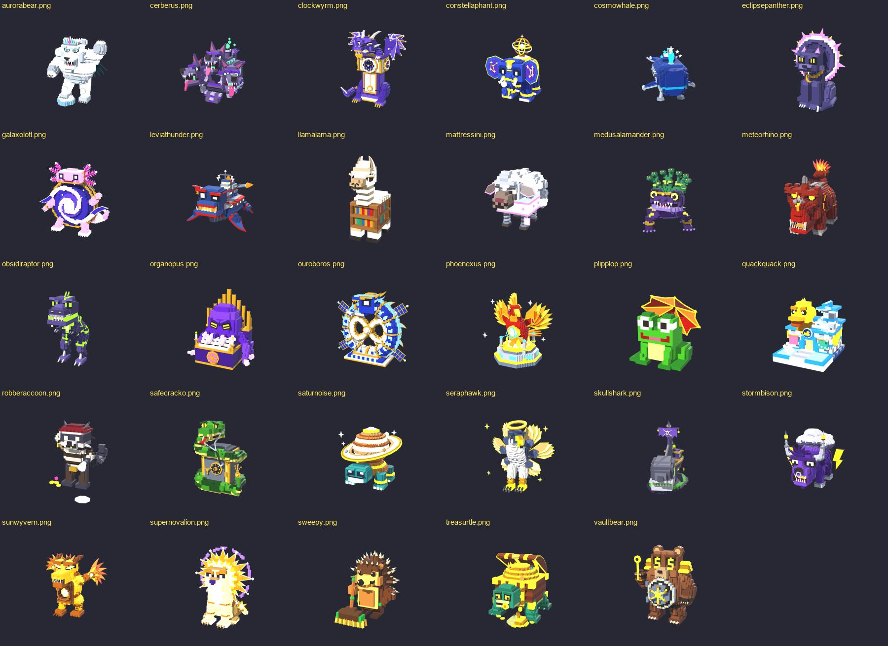

### 02 zombies: renders / action poses / model views
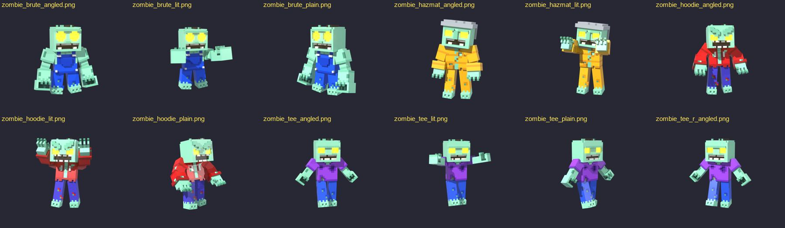
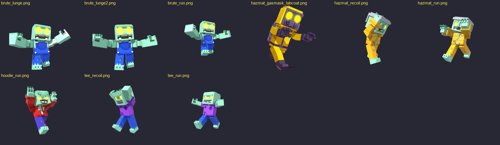
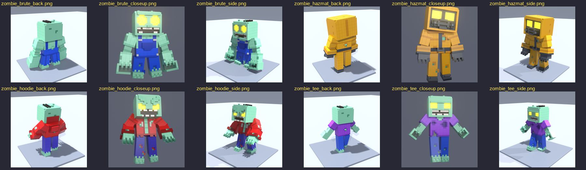

### 03 floors in game, no zombies
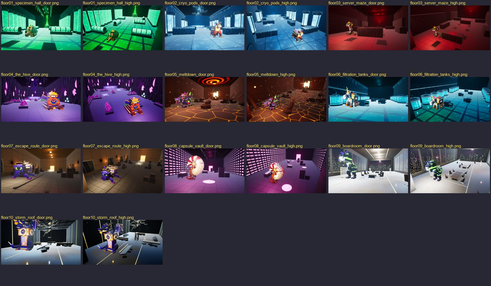

### 04 floor mockups (concept paintings)
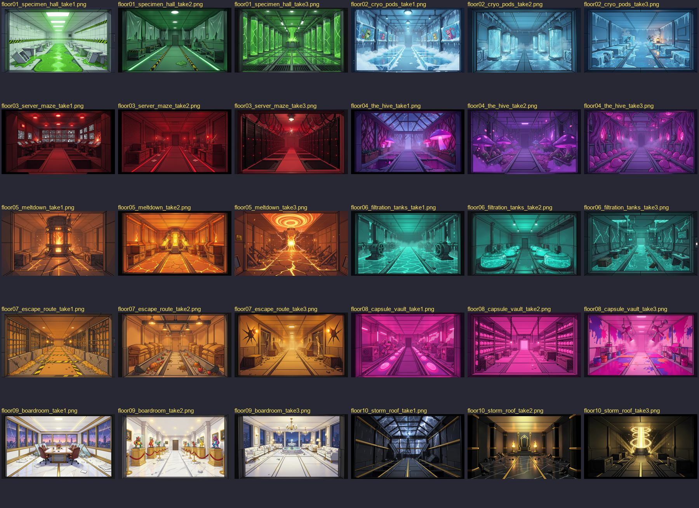

### 05 lobby in game
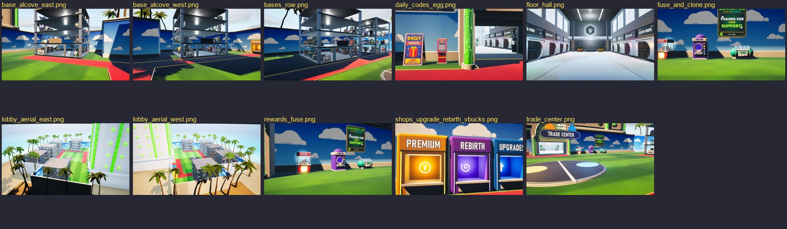

### 06 tower
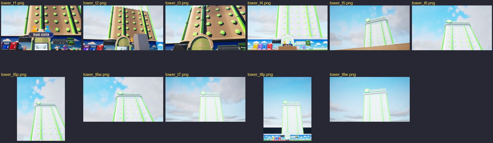

### 07 trailer stills
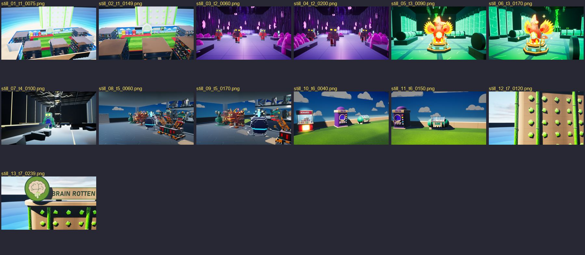

### 08 logos
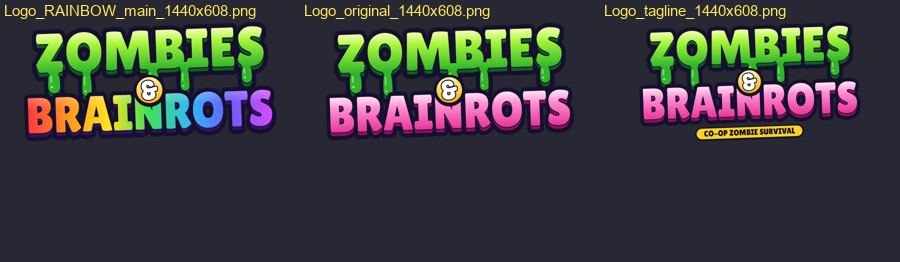

### 09 our thumbnails so far
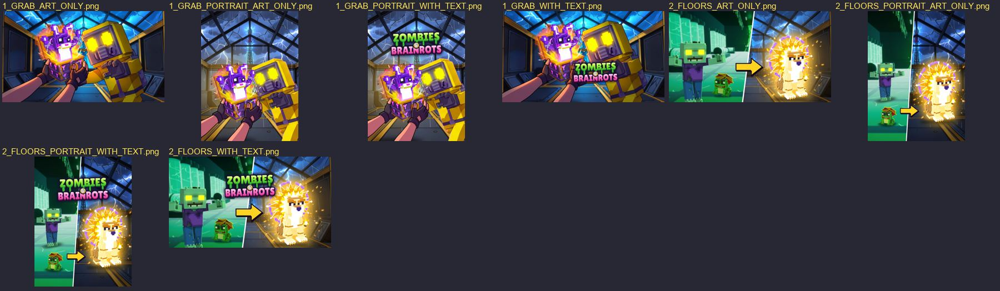
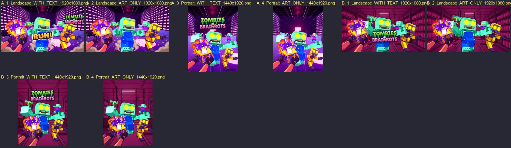
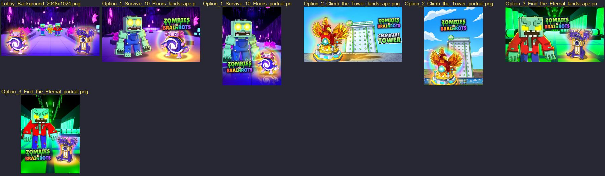

### 10 floor upgrade mockups (2026-11-22): today vs the new look
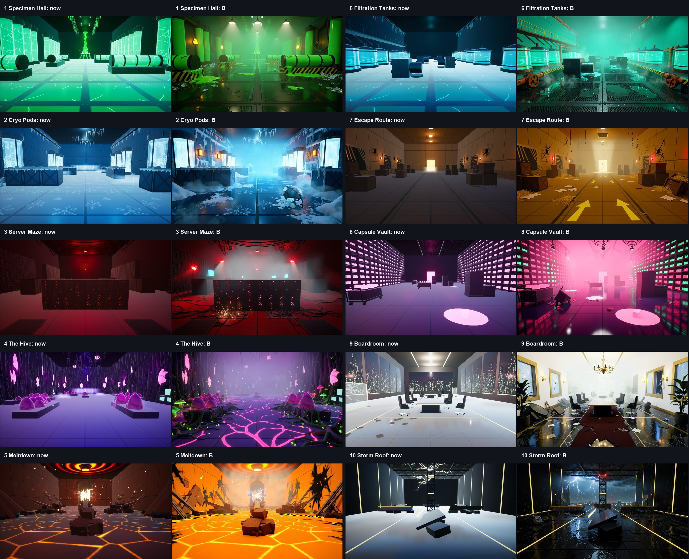

Floor 9 will show a daytime ocean in its windows (the tower stands on an island) and floor 10 gets a glass
greenhouse roof with its back wall smashed open onto the sea; the mockups for those two show the older idea.

Older takes (before the island ground, 2026-11-19/20) sit in the `older_*` folders inside 03 and 05.
